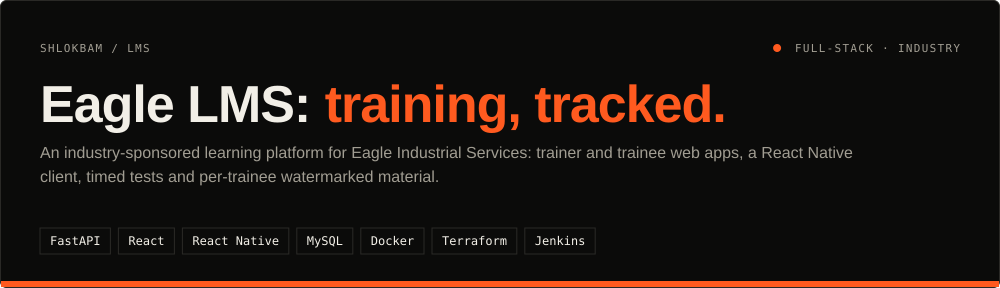
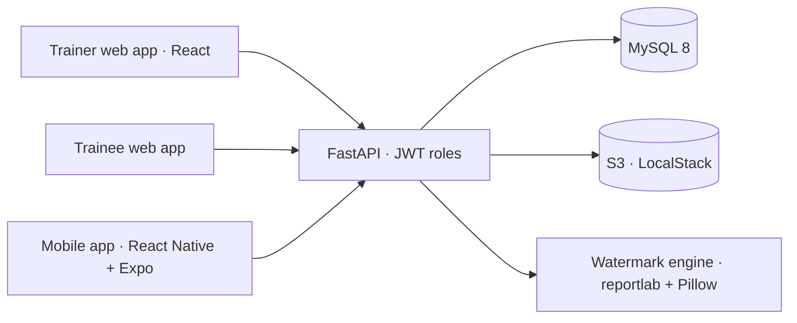
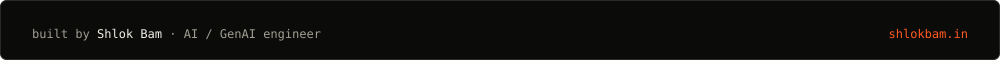

<div align="center">




<a href="#demo">Demo</a> · <a href="#how-it-works">How it works</a> · <a href="#quickstart">Quickstart</a> · <a href="#design-decisions">Decisions</a> · <a href="DEVOPS_PROOF.md">DevOps log</a> · <a href="docs/DETAILS.md">Full notes</a>

</div>

## In one minute

- **Problem:** company training needs controlled content delivery, tests and progress tracking, and course material that can't be passed around anonymously.
- **What this does:** trainers publish content in phases, set timed multiple-choice tests and track each trainee's progress. Trainees learn on the web or a mobile app, and every PDF or image they open carries their own email as a watermark.
- **Result:** delivered as an industry-sponsored team project that I led, with a completion letter from the company. The whole stack runs locally with one `docker compose up`, including a mocked AWS S3.

## Demo

<table>
<tr>
<td></td>
<td></td>
</tr>
<tr>
<td align="center"><sub><b>Trainer dashboard</b></sub></td>
<td align="center"><sub><b>Module reports and scores</b></sub></td>
</tr>
<tr>
<td></td>
<td></td>
</tr>
<tr>
<td align="center"><sub><b>Trainee profile</b></sub></td>
<td align="center"><sub><b>Training calendar</b></sub></td>
</tr>
</table>

## How it works



| Part | What it does |
| :--- | :--- |
| `backend/routers/` | Auth, trainer, trainee, files, progress and notifications APIs |
| `backend/watermark.py` | Stamps each trainee's email onto PDFs and images when they open them |
| `frontend/` | Trainer and trainee dashboards (Vite + React) |
| `mobile/` | React Native + Expo client for field staff |
| `infra/` | Terraform for the S3 bucket, pointed at LocalStack |
| `Jenkinsfile` | Backend tests, Terraform validation and a Docker build check |

## Quickstart

Needs Docker Desktop and the Terraform CLI.

```bash
docker compose up -d                 # MySQL :3307, API :8000, web :5173, LocalStack :4566
cd infra && terraform init && terraform apply -auto-approve   # create the S3 bucket
```

Open `http://localhost:5173` and sign in as `trainer@eagle.com` / `trainer123` or `trainee@eagle.com` / `trainee123`. API docs: `http://localhost:8000/docs`.

## Design decisions

- **Watermark on the way out.** Each trainee gets a personalised copy of a file the first time they open it, so a leaked PDF names its source.
- **A cloud you can run offline.** LocalStack plus Terraform gives real S3 calls and real infrastructure code at zero cost. The bugs that came up along the way are written up in [DEVOPS_PROOF.md](DEVOPS_PROOF.md).
- **One API, three clients.** Trainer web, trainee web and mobile share the same role-checked FastAPI.

## Limits & roadmap

- [ ] Deploy to real AWS (the Terraform is ready; only the LocalStack endpoint changes)
- [ ] Expand the backend test suite beyond the API smoke tests

---

<div align="center">

<a href="https://shlokbam.in"></a>

<a href="https://shlokbam.in">shlokbam.in</a> · <a href="https://www.linkedin.com/in/shlokbam/">LinkedIn</a> · <a href="https://github.com/shlokbam">More projects</a>

</div>
